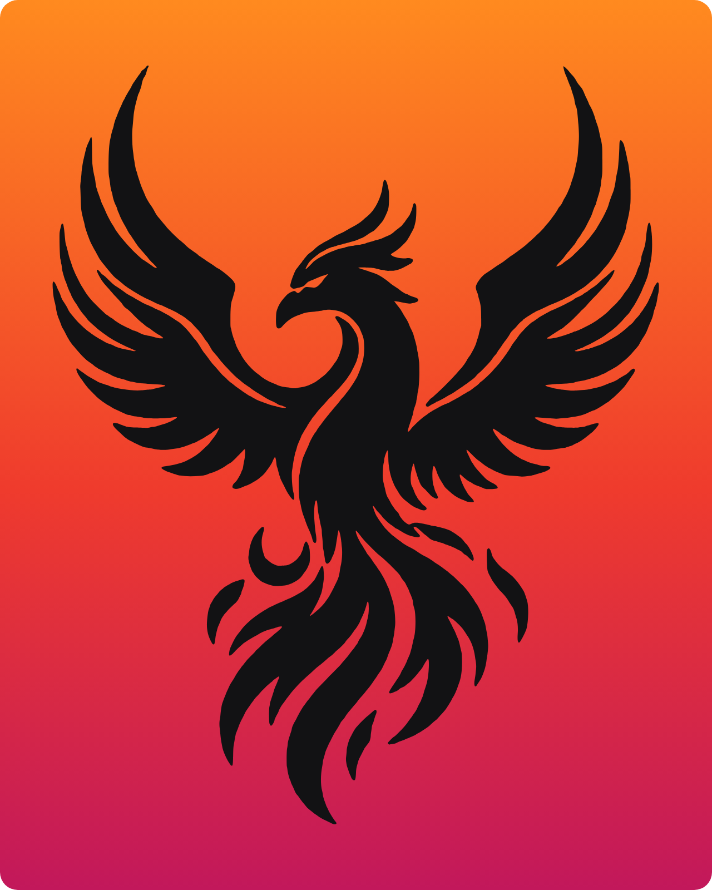

  

<h1 align="center">BEXCEPTIONAL</h1>

<em>Rise above the ordinary.</em>

---

Proyecto Final del **Máster en Desarrollo Full Stack**.

**Bexceptional** es una tienda online de ropa deportiva y una comunidad que
promueve la disciplina, la constancia y la superación personal, inspirada en
el concepto estoico de *areté*: la excelencia que se practica cada día.

## Estado

🚧 En desarrollo: fase de documentación y diseño de la arquitectura.

## Tecnologías previstas

| Capa | Tecnología |
|------|------------|
| Backend | Python · Django · Django REST Framework |
| Base de datos | PostgreSQL |
| Frontend | Plantillas de Django · HTMX · Tailwind CSS · React (Vite) |
| Imágenes | Pillow · django-storages (Cloudinary) |
| Documentación de la API | drf-spectacular |

## Documentación

- [Propuesta del proyecto](docs/propuesta/Propuesta_Bexceptional_Brayan_Echeverri.pdf)

## Autor

**Brayan Echeverri Medina** · echeverry28brayan@gmail.com